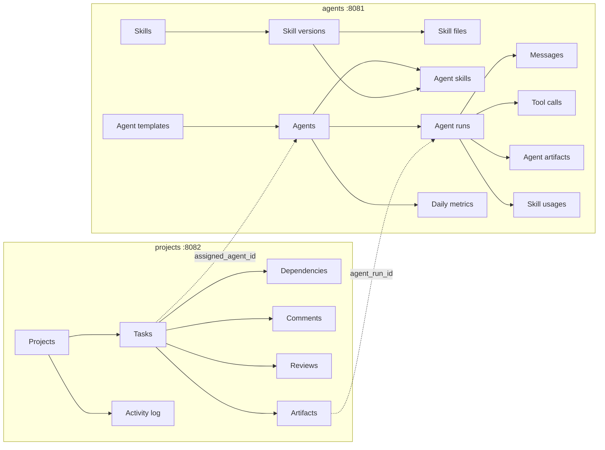

# Kamino

[](https://github.com/preskater/kamino/actions/workflows/ci.yml)
[](LICENSE)
[](rust-toolchain.toml)

**The control plane for managing and monitoring AI agents.**

Kamino is a single system of record for agent work: which agents exist and how they are
configured, which skills they can use, what they are doing right now, and what they produced.
It ships as two small Postgres-backed REST services, one for the agent fleet and one for the
work the fleet is executing.

> **Status:** early. The APIs cover the modelled domains end to end but are pre-1.0; paths and
> response shapes may change between releases. See [CHANGELOG.md](CHANGELOG.md).

## What is Kamino?

Agent platforms tend to grow two disconnected halves: a registry of prompts, tools and
models, and a project tracker where the work actually happens. Kamino models both, keeps
them separate at the database level, and links them with explicit references.

- **Manage** — agent templates, configured agents, skills with versions and bundled files,
  projects, tasks, dependencies, reviews and artifacts. Everything you need to define a
  fleet and the work it should do.
- **Monitor** — runs, messages, tool calls, skill activations, artifacts and daily metrics
  per agent, plus an append-only activity log per project. Everything you need to answer
  "what is running, what did it cost, and what came out of it?"

### Why Kamino?

In Star Wars, Kamino is the ocean planet outside the main galaxy where cloning technology was
developed and the Clone Army was created and trained — a facility that was deliberately
removed from the Jedi archives. Same idea here: templates are cloned into agent instances,
trained with skills, dispatched against tasks, and every action is recorded.

## How it fits together



The two services own separate databases (`kamino_agents`, `kamino_projects`) and apply their
own migrations. Cross-service references are plain UUID columns with no foreign key, so either
service can be deployed, scaled or backed up independently.

## Services

| Service | Binary | Default port | Database | Domain docs |
| --- | --- | --- | --- | --- |
| Agents | `agents` | `8081` | `kamino_agents` | [AGENTS.md](AGENTS.md) |
| Projects | `projects` | `8082` | `kamino_projects` | [PROJECTS.md](PROJECTS.md) |

## Capabilities

| | Capability | Where |
| --- | --- | --- |
| Manage | Agent blueprints and instances | `/v1/agent-templates`, `/v1/agents` |
| Manage | Skill packages, versions and files | `/v1/skills`, `/v1/skills/{id}/versions`, `/v1/skill-versions/{id}/files` |
| Manage | Skills enabled per agent | `/v1/agents/{id}/skills` |
| Manage | Projects, tasks and dependencies | `/v1/projects`, `/v1/projects/{id}/tasks`, `/v1/tasks/{id}/dependencies` |
| Manage | Review workflow and outputs | `/v1/tasks/{id}/reviews`, `/v1/tasks/{id}/artifacts` |
| Monitor | Executions and their conversation | `/v1/agent-runs`, `/v1/agent-runs/{id}/messages`, `/v1/agent-runs/{id}/tool-calls` |
| Monitor | Skill activation per run | `/v1/agent-runs/{id}/skill-usages` |
| Monitor | Produced artifacts | `/v1/agent-artifacts`, `/v1/tasks/{id}/artifacts` |
| Monitor | Token usage and cost | `/v1/agents/{id}/metrics` |
| Monitor | Project audit trail | `/v1/projects/{id}/activity` |

## Repository layout

```
crates/
├── error/      shared error type, JSON envelope and database error mapping
├── config/     environment loading and typed lookups
├── telemetry/  tracing subscriber setup
├── db/         Postgres pool, migrations and readiness
├── query/      pagination models and the runtime-checked SQL query layer
├── http/       extractors, middleware and server lifecycle
├── agents/     /v1 agent, template, skill, run, message, tool call, artifact, metric endpoints
└── projects/   /v1 project, task, dependency, comment, review, artifact, activity endpoints
```

Both services are built on Tokio + axum 0.8 + SQLx (Postgres, runtime-checked queries), with
OpenAPI documents generated by utoipa and served through Swagger UI.

## Quickstart

Prerequisites: Rust 1.94+ (the repo pins `stable`), Docker.

```bash
cp .env.example .env          # ports and connection strings, already pointing at compose
make up                       # postgres:16 on localhost:5432
make run-agents               # http://localhost:8081
make run-projects             # http://localhost:8082
```

Open `http://localhost:8081/docs` or `http://localhost:8082/docs` for Swagger UI.
The raw documents live at `/api-docs/openapi.json`.

Health probes: `GET /health` (liveness) and `GET /health/ready` (runs `SELECT 1`).

## Configuration

Everything is environment driven; `.env` is loaded in development and process variables win.

| Variable | Default | Used by |
| --- | --- | --- |
| `AGENTS_BIND_ADDR` | `0.0.0.0:8081` | agents |
| `AGENTS_DATABASE_URL` | – (required) | agents |
| `AGENTS_DB_MAX_CONNECTIONS` | `10` | agents |
| `PROJECTS_BIND_ADDR` | `0.0.0.0:8082` | projects |
| `PROJECTS_DATABASE_URL` | – (required) | projects |
| `PROJECTS_DB_MAX_CONNECTIONS` | `10` | projects |
| `CORS_ALLOWED_ORIGINS` | `*` | both |
| `RUST_LOG` | `info,<service>=debug,tower_http=debug` | both |
| `DATABASE_URL` | – | tests only (throwaway databases) |

## API conventions

- Base path `/v1`, resources are plural and kebab-cased (`/v1/agent-templates`).
- IDs are application generated UUIDv7, returned as strings.
- Collections accept `limit` (default 20, max 100), `offset`, `sort`, `order` (`asc|desc`), `q`
  (free text search) and resource specific exact-match filters. Unknown filters or sort
  columns are rejected with `400` instead of being silently ignored.
- Responses are `{ "items": [...], "total": n, "limit": n, "offset": n }` for collections and
  the resource object elsewhere.
- Errors share one envelope:

  ```json
  { "error": { "code": "validation_failed", "message": "…", "details": { "name": ["length"] } } }
  ```

  Unique violations map to `409`, missing foreign keys and constraint violations to `422`,
  malformed values to `400`, unknown ids to `404`.
- `PATCH` is partial: omitted and `null` fields are left untouched, so a column cannot be
  cleared through `PATCH` (send `""` or `[]` instead).
- Nested routes fix the parent: `POST /v1/tasks/{task_id}/comments` ignores any `task_id` in
  the body. Flat routes require the parent id in the body or query string.
- `activity_log` is append-only: `GET`/`POST` under `/v1/projects/{id}/activity`, `GET`/`DELETE`
  under `/v1/activity-logs/{id}`. There is no `PATCH`. Project, task, comment, review and
  artifact creation append an entry in the same transaction as the mutation.

### Agents endpoints

`/v1/agent-templates`, `/v1/agents`, `/v1/skills`, `/v1/skills/{id}/versions`,
`/v1/skill-versions/{id}/publish`, `/v1/skill-versions/{id}/files`, `/v1/agent-skills/{id}`,
`/v1/agent-runs`, `/v1/agent-runs/{id}/{messages,tool-calls,skill-usages}`,
`/v1/agent-artifacts`, `/v1/agents/{id}/metrics`.

### Projects endpoints

`/v1/projects`, `/v1/projects/{id}/tasks`, `/v1/tasks`, `/v1/tasks/{id}/dependencies`,
`/v1/tasks/{id}/dependents`, `/v1/tasks/{id}/{comments,reviews,artifacts}`,
`/v1/projects/{id}/activity`.

## Roadmap

The APIs are the data plane. Turning them into a full platform means adding:

- **Orchestrator** — dispatch pending tasks to the right agent, honour task dependencies and
  retries, and drive runs to completion.
- **Auth and multi-tenancy** — API keys or OIDC, per-tenant scoping, and audit-safe access
  control for both services.
- **Live monitoring** — SSE/WebSocket streaming of run events plus a dashboard over runs,
  metrics and activity.
- **Rollups and alerting** — aggregate metrics across agents and projects, budgets, and
  notifications when runs fail or costs exceed a threshold.
- **Event bus and webhooks** — publish run lifecycle events for external integrations.
- **Artifact storage backends** — pluggable S3-compatible storage instead of inline content.

## Tests

Integration tests build the real router and hit a disposable Postgres database created by
`#[sqlx::test]`, so a server must be reachable:

```bash
make up
make test              # or: make test-agents / make test-projects
```

`cargo check`, `cargo build` and `cargo clippy` work without a database.

## Migrations

SQL lives in `crates/*/migrations` and is embedded with `sqlx::migrate!`, applied automatically
on startup. Both services are safe to restart. To inspect the databases:

```bash
make psql-agents
make psql-projects
```

## Docker

```bash
docker compose up --build        # postgres + both APIs
docker compose build             # images only
```

One multi-stage `docker/Dockerfile` builds either binary via the `BINARY` build arg.

## Tooling

```bash
make fmt      # cargo fmt
make lint     # clippy, warnings denied
make check    # cargo check --workspace --all-targets
```

Enable the repository hooks once per clone:

```bash
git config core.hooksPath .githooks
```

The hook runs `cargo fmt --check` and `cargo clippy -D warnings`; `.pre-commit-config.yaml`
provides the same hooks for teams using the `pre-commit` framework. CI mirrors this in
`.github/workflows/ci.yml` (fmt, clippy, audit, tests against a Postgres service, Docker
builds).

## Contributing

Issues and pull requests are welcome. Start with [CONTRIBUTING.md](CONTRIBUTING.md) for the
development setup, code style and migration rules, and read the
[Code of Conduct](CODE_OF_CONDUCT.md). Larger changes should start as an issue so the API
shape can be discussed first.

The domain models live in [AGENTS.md](AGENTS.md) and [PROJECTS.md](PROJECTS.md); keep those
diagrams in sync when tables or relations change.

## Security

Please report vulnerabilities privately through
[GitHub Security Advisories](https://github.com/preskater/kamino/security/advisories/new).
See [SECURITY.md](SECURITY.md) for scope and response times.

## License

[MIT](LICENSE) © 2026 Preskater.
